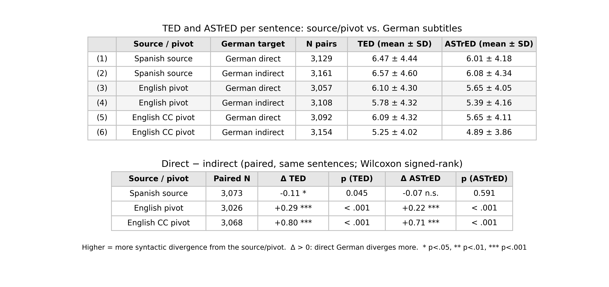
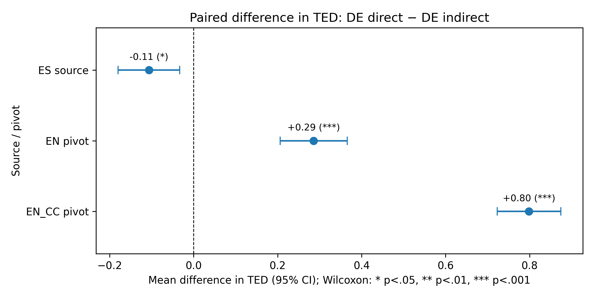
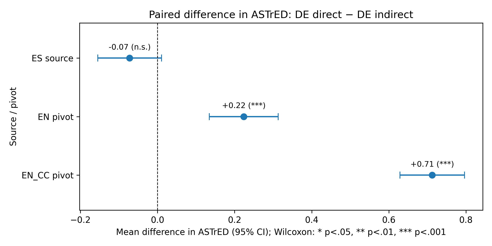
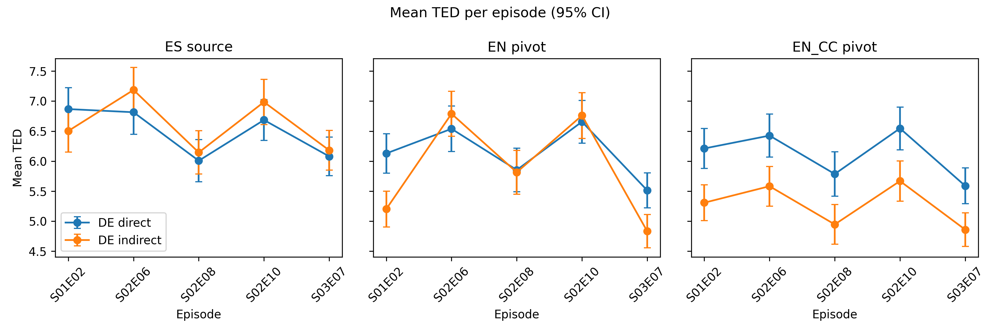

# Analysis-of-Subtitles

## Multi-parallel Cuervos test set
A multi-parallel dataset containing direct/indirect subtitling. Source ES (Mexico), Pivot: EN + EN_CC, Target: DE_ind + DE_dir. Five episodes from Cuervos were selected for the test set. A professional translator, native in German and living in Mexico was commissioned to produce direct translations from Spanish into German. The subtitles were quality proofed by another professional and controversial issues were resolved through agreement. Indirect subtitles as well as source and pivot were obtained from Netflix using the Netflix downloader. 
Preprocessing and Alignment: All subtitle files (.srt) were merged into sentences using punctuation boundaries and written to txt files. These were then manually aligned (Intertext) to create a multiparallel corpus.

### Dataset Size

| Episode | Sentences | Words (ES, EN, DE, Ded) |
|----------|------------|--------------------------|
| S01E02   | 653        |                          |
| S02E06   | 576        |                          |
| S02E08   | 561        |                          |
| S02E10   | 642        |                          |
| S03E07   | 844        | 4567, 4655, 3979, 3928   |
| **Total: 5** | **3276** |                          |

## Repository overview

| Path | Contents |
|------|----------|
| `Subtitles Data/txt/` | Sentence-aligned subtitles, one file per episode and version (`.ES`, `.EN`, `.EN_CC`, `.DE` = indirect, `.DE_Direkt` = direct). Line *n* is the same sentence in every version; `-` marks a subtitle with no counterpart. |
| `Subtitles Data/conllu/` | Stanza UD parses (tokenize, mwt, pos, lemma, depparse) of the txt files, one sentence per aligned line. |
| `Subtitles Data/conllu_chunks/` | The parses split into 50-sentence chunks (ES, EN, DE and DE_Direkt; EN_CC is not chunked). |
| `Data Generation/` | Parsing (`conllu_generation.py`), chunking (`conllu_chunk.py`) and extraction of 45 translationese features (`mega_collector.py`, after Kunilovskaya & Lapshinova-Koltunski 2020). Feature tables are in `Linguistic-features/`. |
| `subtitles_analysis.ipynb`, `Subtitles_analysis/` | Clustering, classification and feature analysis on the translationese features, with plots. |
| `TED_ASTrED/` | Syntactic-divergence analysis (TED and ASTrED) of direct vs. indirect German subtitles. See below. |

## Translationese features (notebook)

`subtitles_analysis.ipynb` uses the 45 features per episode, so there are 5 documents per version and 25 in total. With only 5 documents per version, treat these results as exploratory.

- **K-means (5 clusters):** accuracy 0.72. Spanish is separated perfectly. English and English CC are mostly separated (4/5 each). Direct and indirect German end up in the same cluster.
- **Top 10 features by ANOVA F-test:** `demdets`, `ppron`, `addit`, `mpred`, `infs`, `xcomp`, `nnargs`, `relativ`, `simple`, `indef`. Per-feature boxplots and KDE plots are in `Subtitles_analysis/`.

## TED and ASTrED: direct vs. indirect German subtitles

**Question:** is the direct German (translated from Spanish) or the indirect German (translated via an English pivot) syntactically closer to the Spanish source and to each English pivot?

Both German versions are compared with each of the three other versions, giving six settings:

| | Compared with | German target |
|---|---|---|
| (1) / (2) | Spanish source | direct / indirect |
| (3) / (4) | English pivot | direct / indirect |
| (5) / (6) | English CC pivot | direct / indirect |

### Method

- **TED:** tree edit distance between the dependency trees of the two aligned sentences. Nodes are labelled by UD dependency relation (subtypes stripped) and every insertion, deletion or relabelling costs 1.
- **ASTrED:** Aligned Syntactic Tree Edit Distance (Vanroy, De Clercq, Tezcan, Daems & Macken 2021, *Computational Linguistics* 47(4)). It is TED computed over trees whose nodes are grouped by word alignment.
- **Tools:** both metrics are computed with the [`astred`](https://github.com/BramVanroy/astred) package (0.9.7).
- **Word alignment:** [awesome-align](https://github.com/neulab/awesome-align) with default settings: mBERT, layer 8, softmax threshold 0.001, no fine-tuning.
- **Higher scores** mean more syntactic divergence between the two sentences.
- **Unit:** each sentence pair gets a score, and the tables report the mean per setting.
- **Parses:** the Stanza UD parses in `Subtitles Data/conllu/` are used. Multi-word tokens (e.g. Spanish *del*, German *zum*) are split into their syntactic words. Punctuation, including subtitle dialogue dashes, stays in the trees as the parser produced it.
- **Exclusions:** pairs where either side is only punctuation (the `-` placeholders) are left out. That removes 955 of 19,656 pairs, between 115 and 219 per setting.
- **Direct vs. indirect:** compared on the same source sentences with a two-sided Wilcoxon signed-rank test.

### Results



| Setting | N pairs | TED (mean ± SD) | ASTrED (mean ± SD) |
|---|---|---|---|
| (1) Spanish source → German direct | 3,129 | 6.47 ± 4.44 | 6.01 ± 4.18 |
| (2) Spanish source → German indirect | 3,161 | 6.57 ± 4.60 | 6.08 ± 4.34 |
| (3) English pivot → German direct | 3,057 | 6.10 ± 4.30 | 5.65 ± 4.05 |
| (4) English pivot → German indirect | 3,108 | 5.78 ± 4.32 | 5.39 ± 4.16 |
| (5) English CC pivot → German direct | 3,092 | 6.09 ± 4.32 | 5.65 ± 4.11 |
| (6) English CC pivot → German indirect | 3,154 | 5.25 ± 4.02 | 4.89 ± 3.86 |

**Direct − indirect** (paired on the same sentences):

| Compared with | Paired N | Δ TED | p | Δ ASTrED | p |
|---|---|---|---|---|---|
| Spanish source | 3,073 | −0.11 | .045 | −0.07 | .591 (n.s.) |
| English pivot | 3,026 | +0.29 | < .001 | +0.22 | < .001 |
| English CC pivot | 3,068 | +0.80 | < .001 | +0.71 | < .001 |

### Key findings

1. **Compared with the Spanish source, direct and indirect German are about equally divergent.** By TED, the direct German is very slightly closer to the Spanish (−0.11, p = .045). By ASTrED, there is no significant difference.
2. **Compared with the English pivots, the indirect German is clearly closer than the direct German.** This holds for both metrics. It is consistent with the indirect subtitles having been translated via English, so some of the English sentence structure carries over into the German.
3. **The effect is strongest for English CC** (Δ ≈ 0.8 TED) and appears in all five episodes. For the English pivot it comes from S01E02 and S03E07. In the three season-2 episodes it disappears or slightly reverses; see `TED_ASTrED/figures/*_per_episode.png`. It is not documented which English version the indirect German was translated from.





### Files

- `TED_ASTrED/TED_ASTrED_results.xlsx` contains three sheets:
  - **Summary:** mean, SD and median per setting.
  - **Direct_vs_Indirect:** the paired comparisons.
  - **Per_Episode:** means per episode.
- `TED_ASTrED/sentence_scores.csv`: one row per sentence pair and setting. It includes both sentences, the TED and ASTrED scores, length-normalised scores (score divided by the combined word count of both sentences), the word alignments (`aligns`) and alignment cross-check (`align_identical`).
- `TED_ASTrED/figures/`: plots for both metrics (mean bar plot, paired difference, boxplot, KDE, per episode) and the summary table.

### Reproduce

```bash
python TED_ASTrED/setup_awesome_align.py   # once: installs awesome-align and prepares mBERT in TED_ASTrED/.deps/ (git-ignored)
python TED_ASTrED/compute_ted_astred.py    # writes sentence_scores.csv (runs on GPU if available; slow on CPU)
python TED_ASTrED/make_figures.py
python TED_ASTrED/build_excel.py
```

Requirements: `astred`, `apted`, `torch`, `transformers`, `huggingface_hub`, `safetensors`, `pandas`, `scipy`, `seaborn`, `openpyxl`.

**Implementation notes:**
- **Compatibility patch:** `astred` 0.9.7 was written for an older awesome-align model constructor. `compute_ted_astred.py` changes only how the model is loaded; the alignment code itself is unchanged.
- **Model format:** `setup_awesome_align.py` stores the unchanged mBERT weights as `pytorch_model.bin`, because the awesome-align loader cannot read `.safetensors`.
- **Alignment cross-check:** alignments were also computed with a separate implementation of the same procedure. It matched awesome-align on 18,700 of 18,701 pairs; the per-pair result is in column `align_identical`.
